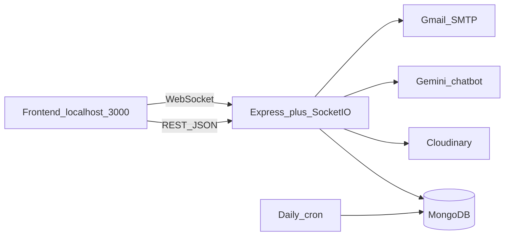
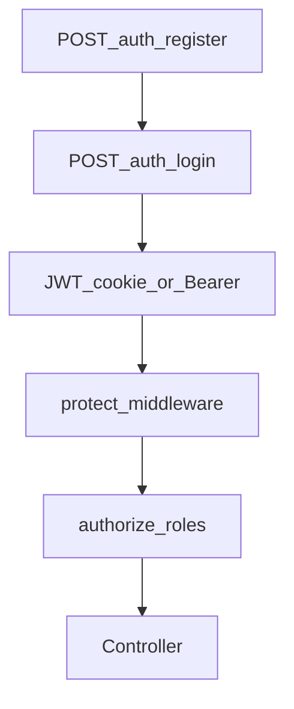
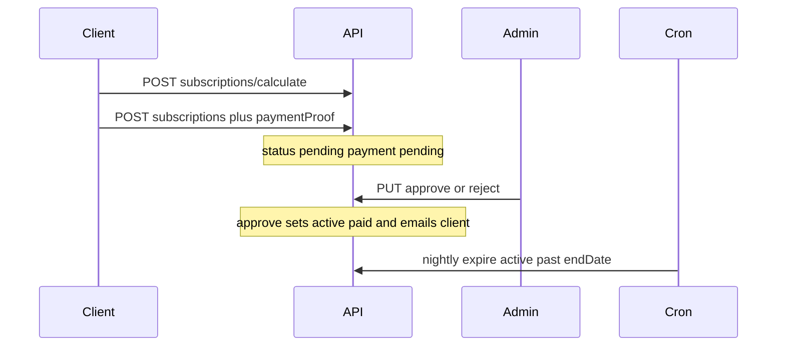
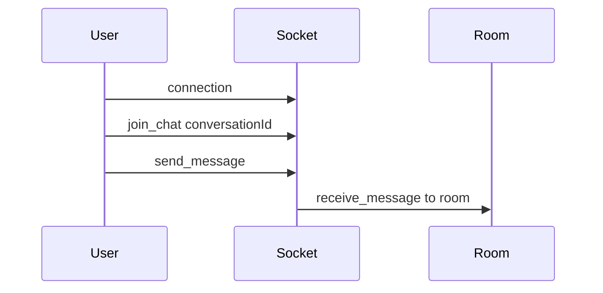
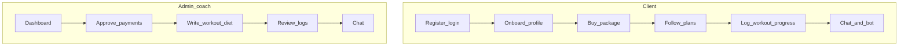

# FitCoach API

Backend for a coach–client fitness app. Clients onboard, subscribe (Instapay + proof), follow workout and diet plans, log progress, and chat with the coach. Admins (coaches) manage packages, approve payments, write plans, and monitor clients.

**Stack:** Express 5 · MongoDB/Mongoose · JWT (cookie or Bearer) · Socket.IO · Cloudinary · Gemini · PDFKit · Nodemailer · node-cron

Base URL: `http://localhost:{PORT}`  
API prefix: `/api/v1`  
Frontend CORS origin (HTTP + Socket.IO): `http://localhost:3000`

---

## Quick start

```bash
npm install
```

Create a `.env` file (do not commit secrets):

```
PORT=5000
NODE_ENV=development
MONGODB_URI=
JWT_SECRET=
CLOUDINARY_CLOUD_NAME=
CLOUDINARY_API_KEY=
CLOUDINARY_API_SECRET=
SMTP_USER=
SMTP_PASS=
GEMINI_API_KEY=
TELEGRAM_BOT_TOKEN=
TELEGRAM_CHAT_ID=
```

```bash
npm start                 # nodemon index.js
npm run seed:packages     # optional package catalog
```

Auth: after login, send the JWT as cookie `token` **or** header `Authorization: Bearer <token>`. Login sets an HTTP-only cookie.

Roles: `client` (default on register) · `admin` (coach).

---

## Architecture









---

## Features

| Area           | What it does                                                                                                                                                   |
| -------------- | -------------------------------------------------------------------------------------------------------------------------------------------------------------- |
| Auth           | Register, login, logout. Passwords hashed with bcrypt. JWT 1 day.                                                                                              |
| Users          | Admin lists, reads, deletes users.                                                                                                                             |
| Client profile | Onboarding (goals, body stats, experience, injuries, food prefs, photos). Own profile + admin CRUD.                                                            |
| Packages       | Public catalog with duration/price options. Admin CRUD. Seed script.                                                                                           |
| Coupons        | Admin CRUD. Any logged-in user can validate a code.                                                                                                            |
| Subscriptions  | Client calculates price, uploads Instapay proof, views own sub. Admin lists, dashboard stats, approve/reject, invoice PDF. Email on process. Daily expire job. |
| Exercises      | Public library. Admin create/update/delete.                                                                                                                    |
| Workout plans  | Admin assigns plan (one per client on create). Client `GET /me`. PDF download. Notify on create/update.                                                        |
| Diet plans     | Admin CRUD. Client `GET /my-diet-plan`. Notify on create.                                                                                                      |
| Progress       | Weight, measurements, body-fat, photo. Own list + admin view by client.                                                                                        |
| Workout logs   | Sets/reps/weight, mood, notes. Own logs + stats + admin view by client.                                                                                        |
| Notifications  | In-app list, mark one/all read.                                                                                                                                |
| Chat           | REST messages + conversations. Socket.IO live rooms. Client can fetch the coach user.                                                                          |
| Fitness bot    | Public Gemini Q&A (fitness/nutrition only).                                                                                                                    |
| Uploads        | Multer + Cloudinary (client images, payment proofs, progress photos).                                                                                          |

### Data models (`models/`)

User · Client · Package · Cupon · Subscription · Exercise · WorkoutPlan · DietPlan · ProgressEntry · workoutLog · Notification · Conversation · Message

---

## Roles

| Access             | Who                                                                                                                             |
| ------------------ | ------------------------------------------------------------------------------------------------------------------------------- |
| Public             | Auth register/login, package catalog, exercise catalog, chatbot                                                                 |
| Any logged-in user | Onboarding, own client profile, coupon validate, progress, workout logs, notifications, chat, workout PDF (if allowed by route) |
| `client`           | Calculate/buy subscription, `GET /subscriptions/me`                                                                             |
| `admin`            | Users, all clients, coupon CRUD, subscription queue, invoices, dashboard, exercise write, workout/diet plan write               |

---

## API routes

All paths are under `/api/v1`.

### Auth `/auth`

| Method | Path        | Access | Purpose        |
| ------ | ----------- | ------ | -------------- |
| POST   | `/register` | Public | Create user    |
| POST   | `/login`    | Public | Set JWT cookie |
| GET    | `/logout`   | Public | Clear cookie   |

### Users `/user`

| Method | Path   | Access | Purpose     |
| ------ | ------ | ------ | ----------- |
| GET    | `/`    | Admin  | List users  |
| GET    | `/:id` | Admin  | Get user    |
| DELETE | `/:id` | Admin  | Delete user |

### Clients `/clients`

| Method | Path   | Access    | Purpose             |
| ------ | ------ | --------- | ------------------- |
| POST   | `/`    | Logged in | Onboarding + images |
| GET    | `/`    | Admin     | List clients        |
| GET    | `/me`  | Logged in | My profile          |
| GET    | `/:id` | Admin     | One client          |
| PUT    | `/:id` | Logged in | Update client       |
| DELETE | `/:id` | Admin     | Delete client       |

### Packages `/package`

| Method | Path   | Access | Purpose       |
| ------ | ------ | ------ | ------------- |
| GET    | `/`    | Public | List packages |
| GET    | `/:id` | Public | One package   |
| POST   | `/`    | Admin  | Create        |
| PUT    | `/:id` | Admin  | Update        |
| DELETE | `/:id` | Admin  | Delete        |

### Coupons `/cupons`

| Method | Path        | Access    | Purpose    |
| ------ | ----------- | --------- | ---------- |
| POST   | `/validate` | Logged in | Check code |
| GET    | `/`         | Admin     | List       |
| POST   | `/`         | Admin     | Create     |
| GET    | `/:id`      | Admin     | One        |
| PUT    | `/:id`      | Admin     | Update     |
| DELETE | `/:id`      | Admin     | Delete     |

### Subscriptions `/subscriptions`

| Method | Path                       | Access | Purpose                   |
| ------ | -------------------------- | ------ | ------------------------- |
| GET    | `/stats/dashboard`         | Admin  | Coach dashboard counts    |
| GET    | `/me`                      | Client | My subscription           |
| POST   | `/calculate`               | Client | Price + coupon            |
| POST   | `/`                        | Client | Buy + payment proof image |
| GET    | `/`                        | Admin  | All subscriptions         |
| PUT    | `/:id/approve`             | Admin  | Activate + email          |
| PUT    | `/:id/reject`              | Admin  | Reject                    |
| GET    | `/:subscriptionId/invoice` | Admin  | Invoice PDF               |

### Exercises `/exercises`

| Method | Path   | Access | Purpose |
| ------ | ------ | ------ | ------- |
| GET    | `/`    | Public | List    |
| GET    | `/:id` | Public | One     |
| POST   | `/`    | Admin  | Create  |
| PUT    | `/:id` | Admin  | Update  |
| DELETE | `/:id` | Admin  | Delete  |

### Workout plans `/workout-plans`

| Method | Path       | Access          | Purpose                                  |
| ------ | ---------- | --------------- | ---------------------------------------- |
| POST   | `/`        | Admin           | Create (fails if client already has one) |
| GET    | `/`        | Admin           | List                                     |
| GET    | `/me`      | Client or admin | My plan                                  |
| GET    | `/:id`     | Admin           | One                                      |
| PUT    | `/:id`     | Admin           | Update                                   |
| DELETE | `/:id`     | Admin           | Delete                                   |
| GET    | `/:id/pdf` | Logged in       | Download PDF                             |

### Diet plans `/diet-plans`

| Method | Path            | Access    | Purpose          |
| ------ | --------------- | --------- | ---------------- |
| POST   | `/`             | Admin     | Create           |
| GET    | `/`             | Admin     | List (paginated) |
| GET    | `/my-diet-plan` | Logged in | My plan          |
| GET    | `/:id`          | Admin     | One              |
| PUT    | `/:id`          | Admin     | Update           |
| DELETE | `/:id`          | Admin     | Delete           |

### Chatbot `/chatbot`

| Method | Path | Access | Purpose                                    |
| ------ | ---- | ------ | ------------------------------------------ |
| POST   | `/`  | Public | Body `{ "question": "..." }` → `{ reply }` |

### Progress `/progress`

| Method | Path         | Access    | Purpose                     |
| ------ | ------------ | --------- | --------------------------- |
| POST   | `/`          | Logged in | Log entry + photo           |
| GET    | `/me`        | Logged in | My entries                  |
| GET    | `/:clientId` | Logged in | Client entries (coach view) |
| DELETE | `/:id`       | Logged in | Delete entry                |

### Workout logs `/workout-logs`

| Method | Path         | Access    | Purpose       |
| ------ | ------------ | --------- | ------------- |
| POST   | `/`          | Logged in | Log a session |
| GET    | `/me`        | Logged in | My logs       |
| GET    | `/me/stats`  | Logged in | My stats      |
| GET    | `/:clientId` | Logged in | Client logs   |

### Notifications `/notifications`

| Method | Path        | Access    | Purpose          |
| ------ | ----------- | --------- | ---------------- |
| GET    | `/me`       | Logged in | My notifications |
| PUT    | `/:id/read` | Logged in | Mark one read    |
| PUT    | `/read-all` | Logged in | Mark all read    |

### Chat `/chat` (all require login)

| Method | Path                        | Access    | Purpose               |
| ------ | --------------------------- | --------- | --------------------- |
| GET    | `/coach`                    | Logged in | Find admin coach user |
| POST   | `/send/:receiverId`         | Logged in | Send text message     |
| GET    | `/conversations`            | Logged in | My threads            |
| GET    | `/messages/:conversationId` | Logged in | Thread messages       |
| GET    | `/with/:userId`             | Logged in | Get or create thread  |

### Health

| Method | Path | Access | Purpose                                           |
| ------ | ---- | ------ | ------------------------------------------------- |
| GET    | `/`  | Public | `{ success, message: "Welcome to FitCoach App" }` |

---

## Socket.IO

Connect to the same HTTP server. CORS: `http://localhost:3000`, credentials on.

| Event             | Direction       | Payload                   | Purpose                    |
| ----------------- | --------------- | ------------------------- | -------------------------- |
| `connection`      | Server          | socket id                 | Client connected           |
| `join_chat`       | Client → server | `conversationId`          | Join room                  |
| `send_message`    | Client → server | `{ conversationId, ... }` | Broadcast to room          |
| `receive_message` | Server → room   | same data                 | Other participant receives |
| `disconnect`      | Server          | —                         | Client left                |

Persist messages via REST (`POST /chat/send/:receiverId`); sockets are for live delivery.

---

## User stories

### Client

1. **Sign up and sign in** — `POST /auth/register`, `POST /auth/login`.
2. **Complete my body/goals profile** — `POST /clients` with photos; later `GET /clients/me`, `PUT /clients/:id`.
3. **Browse coaching packages** — `GET /package`, `GET /package/:id`.
4. **Apply a coupon and see the price** — `POST /cupons/validate`, `POST /subscriptions/calculate`.
5. **Pay with Instapay** — `POST /subscriptions` with `paymentProof` image; wait for coach review.
6. **See my membership** — `GET /subscriptions/me` (`pending` / `active` / `expired` / `cancelled`).
7. **Follow my workout** — `GET /workout-plans/me`, optional PDF `GET /workout-plans/:id/pdf`.
8. **Follow my diet** — `GET /diet-plans/my-diet-plan`.
9. **Log a training day** — `POST /workout-logs`; review `GET /workout-logs/me` and `GET /workout-logs/me/stats`.
10. **Log weight and photos** — `POST /progress`, `GET /progress/me`.
11. **Read alerts** — `GET /notifications/me`, mark read.
12. **Message the coach** — `GET /chat/coach`, then send/list messages; optionally Socket.IO `join_chat`.
13. **Ask the fitness bot** — `POST /chatbot`.
14. **Sign out** — `GET /auth/logout`.

### Admin (coach)

1. **Sign in as admin** — `POST /auth/login` with an admin user.
2. **See dashboard numbers** — `GET /subscriptions/stats/dashboard`.
3. **Manage users and client files** — `/user`, `/clients` list/detail/delete.
4. **Sell packages and coupons** — CRUD `/package` and `/cupons`.
5. **Maintain the exercise library** — write routes on `/exercises`.
6. **Review Instapay proofs** — `GET /subscriptions`, `PUT .../approve` or `.../reject`, email client, `GET .../invoice` PDF.
7. **Assign a workout plan** — `POST /workout-plans` (client is notified). Update/delete as needed. Client gets one plan on create.
8. **Assign a diet plan** — `POST /diet-plans` (client is notified).
9. **Check adherence** — `GET /progress/:clientId`, `GET /workout-logs/:clientId`.
10. **Chat with clients** — `/chat` REST + Socket.IO rooms.
11. **Cron** — every day at midnight, active subscriptions with `endDate` in the past become `expired`.

---

## Client vs admin (who does what)



---

## Background jobs

- **Daily 00:00** (`utils/cronJobs.js`): set `Subscription.status` from `active` to `expired` when `endDate` is before now.

---

## Possible next features

Not implemented yet: forgot-password (SMTP helper already exists), AI auto-generate workout/diet from the client profile, diet meal logs, chatbot history, session booking, enable `helmet` and `express-rate-limit` (already in `package.json`).
